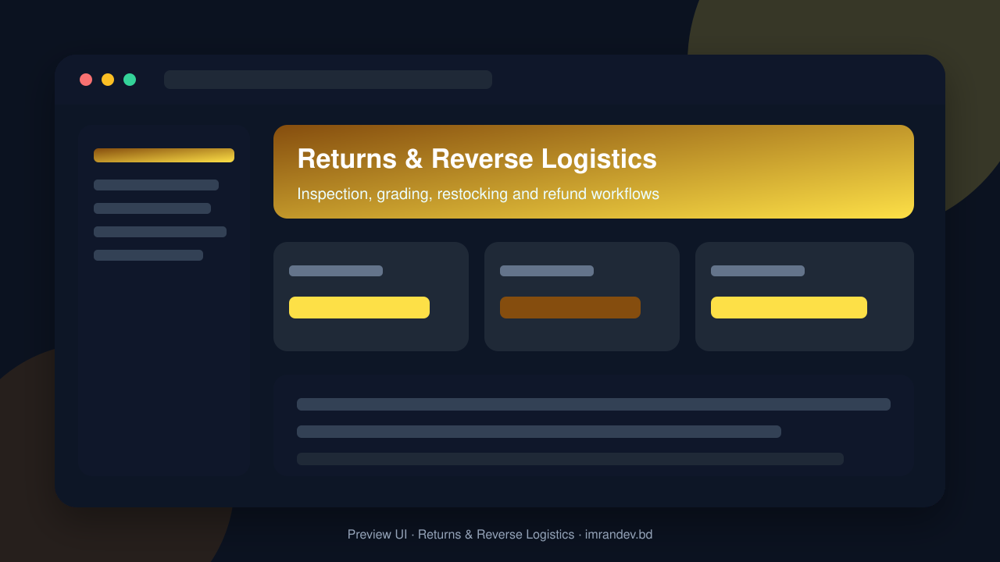
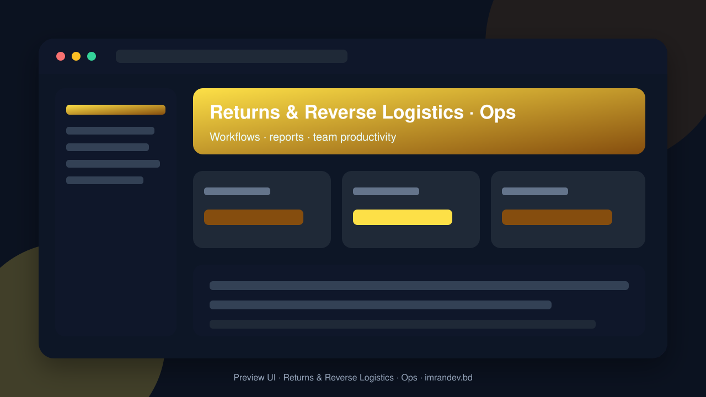

<p align="center">
  
</p>

# Returns & Reverse Logistics

<p align="center"><strong>Inspection, grading, restocking and refund workflows</strong></p>

<p align="center">
  <a href="https://github.com/imranbru99/returns-reverse-logistics-restocking"></a>
  
  
</p>

---

## Overview

**Returns & Reverse Logistics** — Inspection, grading, restocking and refund workflows.

This README documents the **real application features** so GitHub and Google visitors can understand what the product does.

## Product screenshots

| Dashboard | Operations |
| :---: | :---: |
|  |  |

## Application features

### Returns & reverse logistics

- RMA / return authorization intake
- Inbound return receiving
- Inspection, grading and disposition
- Restock, refurbish, scrap or return-to-vendor paths
- Refund / exchange workflow hooks
- Reason codes and defect analytics
- Carrier tracking for reverse pickups
- Warehouse putaway after approved restock

### Detailed modules from product specification

- **Multi-tenancy**
- **Module system (the heart of the product)**
#### Cross-cutting

- USER TYPES (multi-type users, per-tenant roles, all seeded)
- MODULES (build ALL; each independently switchable)
- PUBLIC WEBSITE (many public pages, SEO-ready, fast, multilingual)
- FILAMENT PANELS
- DEMO MODE & SEED DATA
- QUALITY BAR
- DELIVERABLES
- EXECUTION PLAN (follow in order, commit after each)

### Admin screens (Filament resources)

- Announcement management
- Blog Post management
- Carrier Account management
- Cms Page management
- Customer management
- Fraud Signal management
- Inspection management
- Inspection Checklist management
- Integration Connection management
- Knowledge Article management
- Marketplace Listing management
- Order management
- Plan management
- Product management
- Putaway Task management
- Receiving Record management
- Refund management
- Refurbishment Work Order management
- Rma management
- Shipment management
- Store Credit Account management
- Support Ticket management
- Tenant management
- Vendor Claim management
- Work Task management

### Domain data models

- Analytics Event
- Announcement
- Auction
- Auction Bid
- Blog Post
- Carrier Account
- Category
- Cms Page
- Contact Submission
- Customer
- Destruction Certificate
- Disposition
- Exchange Order
- Fraud Signal
- Gift Card
- Inspection
- Inspection Checklist
- Integration Connection
- Integration Sync Log
- Inventory Item
- Invoice
- Knowledge Article
- Liquidation Lot
- Location
- Marketplace Listing
- Marketplace Order
- Module Definition
- Number Sequence
- Order
- Order Item
- Plan
- Product
- Putaway Task
- Receiving Record
- Recycling Partner
- Refund
- Refurbishment Work Order
- Report Definition
- Return Cost Ledger
- Return Policy
- Rma
- Rma Item
- Rma Status History
- Shift
- Shipment
- Staff Profile
- Store Credit Account
- Store Credit Ledger Entry
- Subscription
- Support Ticket
- Sustainability Metric
- Tenant
- Tenant Module
- Usage Meter
- Vendor Claim

## Tech stack

- PHP 8.2+ / Laravel
- Filament admin (where enabled)
- Migrations, seeders, queues
- Vite asset pipeline
- MySQL / SQLite ready

## Quick start

```bash
git clone https://github.com/imranbru99/returns-reverse-logistics-restocking.git
cd returns-reverse-logistics-restocking
composer install
cp .env.example .env
php artisan key:generate
php artisan migrate --seed
npm install && npm run build
php artisan serve
```

## Author

**Imran Ahmed** · https://imrandev.bd · me@imrandev.bd  
GitHub: https://github.com/imranbru99/returns-reverse-logistics-restocking

---
## 🤝 Let's Connect & Collaborate

I am open to **Senior Remote Full-Stack Roles**, AI Platform Architecture Contracts, and Enterprise Technical Advisory.

| Channel | Link |
| :--- | :--- |
| Portfolio | https://imrandev.bd |
| GitHub | https://github.com/imranbru99 |
| LinkedIn | https://linkedin.com/in/imranbru99 |
| Email | me@imrandev.bd |
| WhatsApp | https://wa.me/8801576918420 |
| Packagist | https://packagist.org/packages/imrandevbd/ |

